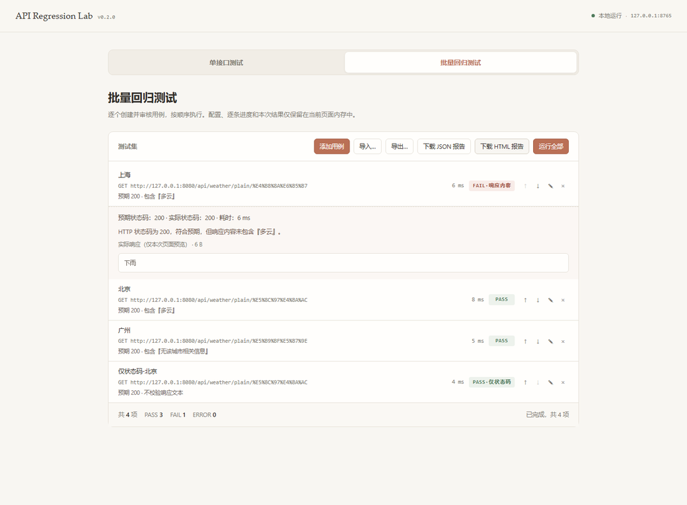
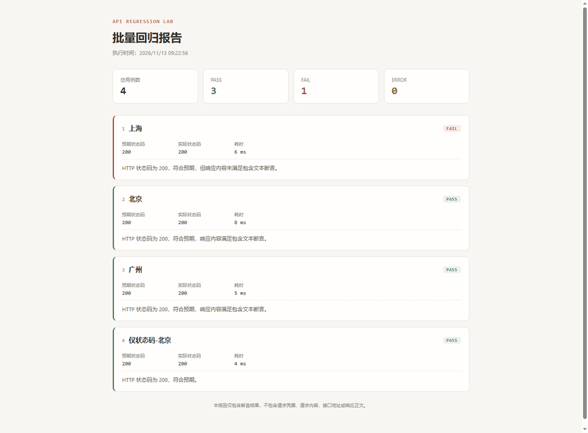

# API Regression Lab

一个轻量级、本地优先的 Java API 回归测试工具。CLI 发送单个 GET / POST 请求或顺序执行批量用例；Web UI 提供可视化的双工作区界面（单接口调试 / 批量回归）、智能断言基线和离线测试报告。

> A lightweight, local-first Java API regression testing tool. Run single GET/POST requests from the CLI or execute a suite of cases. The web UI provides a dual-workspace interface, smart assertion baselines, and offline test reports.

|  |  |
| --- | --- |
| **Java** |  |
| **CI** |  |
| **Release** |  |

---

## 功能概览

- **双工作区 Web UI**：单接口调试 + 批量回归，共享请求编辑器，URL 切换时自动清理旧断言。
- **智能断言基线**：根据真实响应建议 HTTP 状态码及短纯文本断言，需用户审核后保存。
- **批量回归测试**：JSON 测试集导入 / 导出、逐条执行、实时进度、失败原因中文说明。
- **双格式离线报告**：JSON Report v1 + 独立离线 HTML 报告（默认不含凭据、URL、请求体或响应正文）。
- **CLI 批量执行**：`--suite` 顺序执行单用例文件清单，输出汇总与 JSON 报告。
- **本地优先 / 安全边界**：Web Server 仅监听 loopback（`127.0.0.1:8765`），跨站请求返回 403，敏感请求头自动脱敏，过期响应不能被保存为新基线。

## 界面预览

单接口测试（桌面）：


批量回归测试：



离线 HTML 报告：



## 快速开始

**前置要求**：JDK 21（其他版本不支持）。

### 方式一：下载已发布 JAR（推荐）

1. 从 [Release v0.3.0](https://github.com/Yik11Yueuii/api-regression-lab/releases/tag/v0.3.0) 下载 `api-regression-lab-0.3.0.jar`。
2. 运行：

```bash
java -jar api-regression-lab-0.3.0.jar --web
```

3. 浏览器访问 <http://127.0.0.1:8765/>。

### 方式二：从源码构建

```bash
git clone https://github.com/Yik11Yueuii/api-regression-lab.git
cd api-regression-lab
mvn clean package
```

构建成功后使用 Windows 用户可直接双击仓库根目录的 `start-web.bat`（脚本自动检测 JDK 21、校验 JAR 并打开浏览器），或手动启动：

```bash
java -jar target/api-regression-lab-0.3.0.jar --web
```

### CLI 单用例

```bash
java -jar target/api-regression-lab-0.3.0.jar \
  --url http://localhost:8080/api/weather \
  --expect-status 200 \
  --expect-contains "多云"
```

完整参数见 [CLI 参考](docs/cli-reference.md)。

## 技术栈

| 层 | 技术 |
| --- | --- |
| 语言 / 运行时 | Java 21 |
| HTTP 客户端 | `java.net.http.HttpClient`（JDK 内置） |
| Web Server | `com.sun.net.httpserver.HttpServer`（JDK 内置，仅 loopback） |
| JSON 解析 | Jackson |
| 构建 | Maven 3.8.5+，Shade Plugin 打包可自包含 JAR |
| 前端 | 原生 HTML / CSS / JavaScript（无框架、无外部 CDN） |
| 测试 | JUnit 5（单元 + 子进程集成） |
| CI | GitHub Actions（Ubuntu + Temurin JDK 21） |

## 文档入口

| 文档 | 适用场景 |
| --- | --- |
| [CLI 参考](docs/cli-reference.md) | 命令行参数、单用例 JSON、suite 批量执行、JSON 报告、退出码 |
| [Web UI 使用](docs/web-ui.md) | 界面操作、智能断言基线、批量测试集 JSON 格式、HTML 报告、Web 执行接口 |
| [构建、测试与安全边界](docs/development.md) | `mvn package` / `mvn test`、CI 说明、安全边界、隐私规则、已知限制 |

## 已知限制

- 仅支持 `GET` / `POST`，无 PUT / DELETE / 其他方法。
- 断言只支持状态码和响应文本包含判断，不支持 JSONPath / 正则 / 字段级校验。
- 批量执行顺序调用，无并发、失败重试或变量关联。
- Web 批量测试集上限 20 条，刷新页面丢失。
- 无历史结果比较或趋势统计。

详细说明见 [构建、测试与安全边界](docs/development.md)。

## License

本项目暂未指定开源许可证；请按仓库内实际 LICENSE 文件为准使用。
